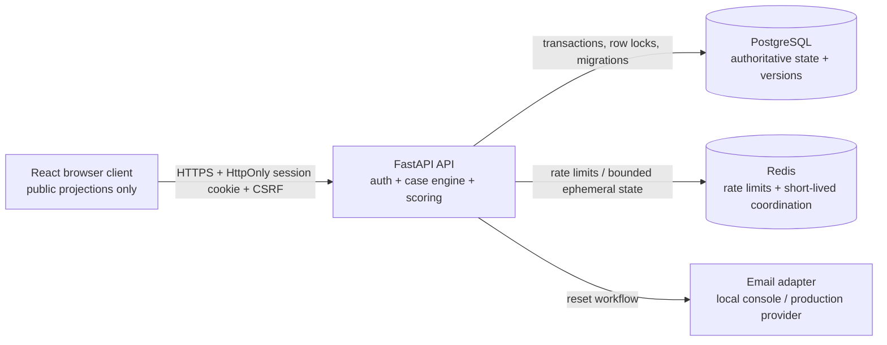

# MiguelMiguel — Architecture and Data/API Contracts

> **Superseded:** This document describes the earlier web-game plan. Do not use it as implementation authority for the Godot visual novel. See `GAME_BIBLE.md`, `TECHNICAL_DESIGN.md`, and `GATE_1_PLANNING_AUDIT.md`.

**Status:** Gates 1–3 planning draft
**Core stack:** React + TypeScript, FastAPI + Python, PostgreSQL, Redis
**Runtime shape:** static frontend, API service, PostgreSQL, Redis

## 1. Architectural stance

The server is authoritative for identity assignment, case-version selection, Inquiry Points, state meters, prerequisites, unlocks, connections, score, progression, and ownership. The browser is a projection and interaction client. It may hold presentation state and unsent note drafts; it may not hold private profiles, hidden solution graphs, exact subject-role truth, or a client-trusted score.

Dialogue is deterministic and handcrafted. Case definitions are versioned, validated trusted input stored server-side, and loaded by the API's case engine. No runtime LLM, generative AI, procedural mystery assembly, or client-side substantive randomness is permitted.

## 2. Proposed repository shape

```text
MiguelMiguel/
├─ apps/
│  ├─ web/                 # React + TypeScript client
│  └─ api/                 # FastAPI service and pure case engine
├─ packages/
│  ├─ contracts/           # generated/hand-maintained public schemas
│  └─ ui/                  # shared tokens/components if useful
├─ cases/
│  ├─ definitions/         # trusted authored source, never public web assets
│  └─ fixtures/             # solvability and engine test fixtures
├─ db/
│  ├─ migrations/
│  └─ seeds/
├─ docs/
├─ tests/
│  ├─ unit/
│  ├─ integration/
│  ├─ component/
│  └─ e2e/
├─ .github/workflows/
├─ docker-compose.yml
├─ .env.example
├─ README.md
└─ SECURITY.md
```

The final implementation may adjust package boundaries if it preserves the contracts here. Private case definitions must not be placed in `apps/web/public`, shipped in an unprotected frontend bundle, or exposed through source maps.

## 3. Runtime topology



### Request lifecycle

1. Middleware creates or propagates a correlation ID, validates body size, security headers, origin/CORS policy, and CSRF for state-changing cookie-authenticated requests.
2. Authentication middleware resolves the opaque session or guest credential to an owner context.
3. Route handler validates Pydantic input and idempotency/state-version headers.
4. Centralized authorization scopes the target entity to the owner context.
5. Domain service loads the immutable case version and executes a pure case-engine transition.
6. A database transaction locks the run, checks idempotency and state version, applies the transition, records an action, and returns a public projection.
7. The response contains safe machine-readable errors, a new state version, and a correlation ID; never a private solution payload before accusation.

## 4. Data model and ER diagram

The design uses UUIDs for externally visible identifiers, with database-generated timestamps and explicit ownership columns. `case_versions` are immutable once referenced by a run.

```mermaid
erDiagram
  USERS ||--o{ SESSIONS : owns
  USERS ||--o{ GUEST_CREDENTIALS : may_claim
  USERS ||--o{ RUNS : owns
  GUEST_CREDENTIALS ||--o{ RUNS : owns_before_claim
  CASES ||--o{ CASE_VERSIONS : publishes
  CASE_VERSIONS ||--o{ RUNS : instantiates
  RUNS ||--o{ RUN_ACTIONS : records
  RUNS ||--o{ RUN_UNLOCKS : unlocks
  RUNS ||--o{ RUN_SUBJECT_STATES : tracks
  RUNS ||--o{ NOTEBOOK_ITEMS : contains
  RUNS ||--o{ CONNECTIONS : proposes
  RUNS ||--o| ACCUSATIONS : finalizes
  ACCUSATIONS ||--o{ ACCUSATION_SOURCES : cites
  USERS ||--o{ USER_CASE_PROGRESS : earns
  CASES ||--o{ USER_CASE_PROGRESS : tracks
  USERS ||--o{ USER_ACHIEVEMENTS : unlocks
  ACHIEVEMENTS ||--o{ USER_ACHIEVEMENTS : defines
  USERS ||--o{ AUDIT_EVENTS : creates

  USERS {
    uuid id PK
    text email UK
    text password_hash
    text status
    timestamptz created_at
    timestamptz deleted_at
  }
  SESSIONS {
    uuid id PK
    uuid user_id FK
    text token_hash UK
    timestamptz expires_at
    timestamptz revoked_at
    text csrf_hash
  }
  GUEST_CREDENTIALS {
    uuid id PK
    text credential_hash UK
    timestamptz expires_at
    timestamptz claimed_at
    uuid claimed_by FK
  }
  CASES {
    uuid id PK
    text slug UK
    text title
    int sequence_number UK
    text status
  }
  CASE_VERSIONS {
    uuid id PK
    uuid case_id FK
    int version_number
    jsonb definition
    text definition_hash
    text status
  }
  RUNS {
    uuid id PK
    uuid user_id FK
    uuid guest_credential_id FK
    uuid case_version_id FK
    text status
    int state_version
    int ip_remaining
    jsonb public_state
    bytea role_seed_ciphertext
    timestamptz completed_at
  }
  RUN_ACTIONS {
    uuid id PK
    uuid run_id FK
    int sequence_number
    text idempotency_key
    text action_type
    text payload_hash
    jsonb safe_result
    int state_version_after
    timestamptz created_at
  }
  RUN_UNLOCKS {
    uuid id PK
    uuid run_id FK
    text content_type
    text content_id
    uuid unlocked_by_action_id FK
    timestamptz unlocked_at
  }
  RUN_SUBJECT_STATES {
    uuid id PK
    uuid run_id FK
    text subject_position
    int trust_exact
    int stress_exact
    int hostility_exact
    jsonb authored_flags
  }
  NOTEBOOK_ITEMS {
    uuid id PK
    uuid run_id FK
    text source_type
    text source_id
    text note_text
    boolean is_pinned
    timestamptz updated_at
  }
  CONNECTIONS {
    uuid id PK
    uuid run_id FK
    text left_source_type
    text left_source_id
    text right_source_type
    text right_source_id
    text connection_type
    text validation_state
  }
  ACCUSATIONS {
    uuid id PK
    uuid run_id FK UK
    text conclusion
    text copy_strategy
    text confidence
    boolean is_conclusion_correct
    int reasoning_score
    int efficiency_score
    int total_score
    text grade
    timestamptz submitted_at
  }
```

### Relational invariants

- A run belongs to exactly one account or one unclaimed guest credential; conversion transfers ownership transactionally.
- `UNIQUE(run_id, sequence_number)` and `UNIQUE(run_id, idempotency_key)` prevent duplicate action sequences and replayed paid actions.
- `UNIQUE(run_id, content_type, content_id)` prevents duplicate unlocks.
- `UNIQUE(run_id)` on accusations makes completion immutable.
- All run-dependent queries include authenticated `user_id` or verified guest ownership in the predicate.
- Case version definitions are append-only after publication; active runs retain their referenced version.
- Exact subject state and role seed are private; the public projection contains qualitative states only.

## 5. Case-definition contract

The canonical authored source is a validated JSON document loaded by the API and seeded into `case_versions.definition`. The schema proposal is intentionally explicit so a reviewer can verify reachability and solvability without opening code.

### 5.1 Top-level JSON shape

```json
{
  "schema_version": "1.0",
  "case_id": "case-01",
  "slug": "the-familiar-error",
  "version": 1,
  "title_key": "case01.title",
  "difficulty": "accessible",
  "starting_ip": 12,
  "allowed_conclusions": ["subject_a", "subject_b"],
  "copy_strategies": ["incomplete_copy"],
  "public_briefing": {
    "record_key": "case01.briefing.record",
    "incident_key": "case01.briefing.incident",
    "objective_key": "case01.briefing.objective"
  },
  "identity_profiles": {},
  "questions": [],
  "evidence": [],
  "solution_graph": {},
  "scoring": {},
  "debrief": {}
}
```

### 5.2 Private identity profile

`identity_profiles` stays server-side and contains:

- Official identity: legal name, age, birthday, hometown, education, occupation.
- Preferences: favorite/disliked food, color, music, place, and routines.
- Personality: honesty, patience, empathy, confidence, humor, impulsiveness, and shame sensitivity.
- Relationships: person, role, closeness, conflict, shared memories, and protected facts.
- Memories: time, location, participants, sequence, objects, sensory details, emotions, hidden cause, and certainty.
- Habits: phrases, nervous gesture, thinking behavior, conversational rhythm, and lying behavior.
- Secrets: fact, motive for concealment, triggers, willingness to confess, and supporting evidence.
- Knowledge boundaries: known by original, copied, distorted, inferred, or absent.
- Deterministic behavior rules: question/evidence/state prerequisites and exact deltas.

### 5.3 Question/answer node

Every answer node must include at least:

```json
{
  "id": "q01.answer.a",
  "speaker": "subject_a",
  "target_mode": "both",
  "question_id": "q01",
  "response_key": "case01.q01.a",
  "stage_direction_key": "case01.q01.a.stage",
  "required_prerequisites": [],
  "ip_cost": 1,
  "state_deltas": {
    "trust": 0,
    "stress": 1,
    "hostility": 0
  },
  "facts_asserted": ["fact.childhood.blue-bike"],
  "facts_concealed": ["fact.childhood.sequence"],
  "follow_ups_unlocked": ["followup.q01.sequence"],
  "evidence_unlocked": [],
  "logical_connection_ids": ["link.01"],
  "localization_key": "case01.q01.a"
}
```

Cosmetic phrasing variants may be selected from a server-provided deterministic run seed only when all variants share identical logical content, facts, unlocks, and deltas. Substantive answer choice is never client-randomized.

### 5.4 Evidence, connection, and scoring contract

Evidence nodes define public availability, examination cost, source type, visible content, facts asserted, facts withheld, and authored connection participation. A connection rule defines the two source IDs, type, required facts/prerequisites, validation result, and reasoning-score weight. Invalid connections remain private hypotheses and reveal no alternative hidden links.

The solution graph contains:

- one or more valid conclusion nodes;
- supporting, weakening, and neutral links;
- copy-strategy requirements;
- false assumptions to call out in debrief;
- the minimum evidence set for solvability;
- independent solution paths for Case 1 and any case that promises them;
- Case 5's objective fact resolution and epilogue choice map.

## 6. Public/private projection rules

### Public before accusation

Allowed:

- case title, public briefing, case status, and action budget;
- current run ID, status, state version, IP remaining;
- subject positions A/B, qualitative trust/stress/hostility labels;
- statements and evidence already unlocked by committed actions;
- authored text, visible stage direction, pin state, notes, suspicion estimate, and safe connection validation state;
- available question IDs and display metadata when prerequisites are met;
- safe error codes and unlock announcements.

Forbidden:

- official identity, actual original/copy role, private profile, hidden knowledge map, untriggered answer text, private facts, solution graph, score formula internals that reveal future links, or the complete case-definition JSON;
- exact trust/stress/hostility integers;
- role seed or any reversible encoding of it;
- other players' runs, progress, notes, accusations, or case attempts.

### Public after accusation/debrief

The API may return the authored debrief projection for the completed run, including the correct conclusion, private facts needed to explain the result, validated links, missed clues, score breakdown, and the case-specific moral epilogue. It still must not return unrelated users' data or secret operational fields.

## 7. API inventory

All mutating run actions require `Idempotency-Key` and `If-State-Version` (or the named equivalent `expected_state_version`) and return a new `state_version`. Status codes and stable error codes must be documented in the generated OpenAPI document.

| Method | Route | Auth | Public result |
| --- | --- | --- | --- |
| POST | `/api/auth/register` | anonymous | session + user summary; rate limited |
| POST | `/api/auth/login` | anonymous | rotated session + user summary |
| POST | `/api/auth/logout` | session/guest | revocation result |
| GET | `/api/auth/me` | session/guest | current public identity/guest state |
| POST | `/api/auth/password/forgot` | anonymous | generic acknowledgement |
| POST | `/api/auth/password/reset` | reset token | rotated authenticated session |
| POST | `/api/guests` | anonymous | guest session/credential metadata |
| POST | `/api/guests/claim` | guest + authenticated account | transfer summary; old guest invalidated |
| GET | `/api/cases` | session/guest | case archive with unlocked/progress projection |
| GET | `/api/cases/{case_slug}/briefing` | session/guest | public briefing only |
| POST | `/api/cases/{case_slug}/runs` | session/guest | created run public projection |
| GET | `/api/runs/{run_id}` | owner | current public run state |
| POST | `/api/runs/{run_id}/begin` | owner | initial statements and state |
| POST | `/api/runs/{run_id}/questions/{question_id}/ask` | owner | answer pair, unlocks, state deltas as qualitative projection |
| POST | `/api/runs/{run_id}/evidence/{evidence_id}/examine` | owner | examined evidence projection |
| POST | `/api/runs/{run_id}/statements/{statement_id}/challenge` | owner | challenged response and authored unlocks |
| POST | `/api/runs/{run_id}/hints` | owner | bounded hint projection, penalty metadata |
| PUT | `/api/runs/{run_id}/suspicion` | owner | saved private estimate |
| GET | `/api/runs/{run_id}/notebook` | owner | own pins, notes, and connections |
| POST | `/api/runs/{run_id}/notebook` | owner | created note/pin projection |
| PATCH | `/api/runs/{run_id}/notebook/{item_id}` | owner | updated note/pin projection |
| DELETE | `/api/runs/{run_id}/notebook/{item_id}` | owner | deletion acknowledgement |
| POST | `/api/runs/{run_id}/connections` | owner | hypothesis/validated/rejected connection |
| DELETE | `/api/runs/{run_id}/connections/{connection_id}` | owner | deletion acknowledgement |
| POST | `/api/runs/{run_id}/accusation` | owner | immutable result summary and debrief availability |
| GET | `/api/runs/{run_id}/debrief` | owner, completed | completed-run debrief projection |
| GET | `/api/progress` | session/guest | own progress summary |
| GET | `/api/achievements` | session/guest | own achievement projection |
| PATCH | `/api/settings` | session/guest | own presentation/accessibility settings |
| GET | `/health/live` | anonymous | process liveness only |
| GET | `/health/ready` | anonymous/internal | dependency readiness without secrets |

### Route behavior rules

- `401` for missing/expired authentication; `403` for authenticated ownership denial; do not collapse authorization into a UUID existence oracle where that would leak data.
- `404` for missing public resources or intentionally indistinguishable private objects; error body contains stable code and safe message.
- `409` for stale state, duplicate completion, or idempotency-key payload mismatch; include safe current version metadata.
- `422` for bounded schema/validation errors.
- `429` for rate limits with retry guidance.
- `503` for unavailable dependencies without stack traces or solution payloads.

## 8. Idempotency and concurrency

For each paid action and accusation:

1. Validate a UUID-like or bounded idempotency key and request hash.
2. Start a database transaction.
3. Lock the target run row (`SELECT ... FOR UPDATE`) or use a safe equivalent.
4. Check `run_actions` for the key. If the payload hash matches, return the saved safe result. If it differs, return `409 IDEMPOTENCY_KEY_REUSED`.
5. Compare expected state version. If stale, return `409 STALE_STATE` without spending IP.
6. Validate ownership, action availability, prerequisites, and IP.
7. Execute the pure case-engine transition.
8. Persist action, unlocks, state, and new version atomically.
9. Commit and return the stored public projection.

The same transaction protects against insufficient-IP races, duplicate accusations, concurrent tabs, and timeout/retry ambiguity. Redis may provide rate limits but cannot be the source of truth for game state.

## 9. Authentication, ownership, and security boundaries

- Opaque server-side sessions in `HttpOnly`, `Secure`, `SameSite=Lax` cookies; use `Strict` if compatible with the chosen reset flow.
- Session identifiers and reset tokens are hashed in the database; rotate sessions on login and ownership/privilege transitions.
- CSRF protection covers state-changing cookie-authenticated requests; exact CORS allowlist and no wildcard credentials.
- Argon2id parameters are documented with an upgrade path.
- Centralized owner scope is mandatory for runs, notes, connections, accusations, progress, settings, and debriefs.
- Never trust client-provided user ID, role, IP cost, state delta, unlock, score, or conclusion correctness.
- Pydantic validation bounds all strings, lists, IDs, notes, and request bodies.
- React escapes untrusted output; MVP narrative is plain text.
- Security headers include CSP, HSTS in production, X-Content-Type-Options, Referrer-Policy, Permissions-Policy, and frame protection through CSP.
- Logs include correlation IDs and safe event metadata, never passwords, reset/session tokens, notes, raw sensitive bodies, or hidden case solutions.

Detailed abuse cases and controls are in [`THREAT_MODEL.md`](THREAT_MODEL.md).

## 10. Operational and deployment contracts

- Local development uses Docker Compose for PostgreSQL and Redis plus API/web processes.
- Migrations are explicit and reversible where practical; seed is deterministic and validates all five case definitions.
- Startup validates required environment variables and database connectivity.
- `/health/live` checks process liveness; `/health/ready` checks configured dependencies and returns no credentials.
- PostgreSQL backups, restore drills, Redis recovery expectations, and migration rollback guidance belong in `SECURITY.md` and deployment docs.
- Production frontend is route-split and served from a static host or CDN; the API is containerized.
- Source maps are withheld from public production or verified not to contain private case content.

## 11. Environment contract

Names are planned here; values belong only in local secret management or deployment configuration.

| Variable | Required | Purpose |
| --- | --- | --- |
| `APP_ENV` | yes | `development`, `test`, or `production` |
| `DATABASE_URL` | yes | PostgreSQL connection string |
| `REDIS_URL` | yes | Redis connection string |
| `SESSION_SECRET` | yes | Session signing/encryption secret; never committed |
| `CSRF_SECRET` | yes | CSRF token secret |
| `ARGON2_MEMORY_COST` | yes | Documented Argon2id parameter |
| `ARGON2_TIME_COST` | yes | Documented Argon2id parameter |
| `ARGON2_PARALLELISM` | yes | Documented Argon2id parameter |
| `FRONTEND_ORIGIN` | yes | Exact allowed frontend origin |
| `RESET_EMAIL_MODE` | yes | `console` locally or provider adapter in production |
| `RESET_EMAIL_FROM` | production | Sender address |
| `RESET_EMAIL_PROVIDER_KEY` | production | Provider secret, if used |
| `LOG_LEVEL` | no | Safe operational logging level |

## 12. Implementation gates

### Gate 1 — Product and narrative contract

Approve PRD scope, personas, goals/non-goals, five case spines, scoring model, and open-question defaults.

### Gate 2 — Experience and visual contract

Approve tokens, spatial investigation layout, subject-neutral semantics, responsive behavior, component states, and accessibility requirements.

### Gate 3 — Technical and case contract

Approve data model, public/private projection boundary, idempotency/concurrency rules, case JSON/Pydantic shape, security boundary, and test strategy.

Only after all three gates are approved should implementation begin with monorepo scaffolding and health endpoints.
