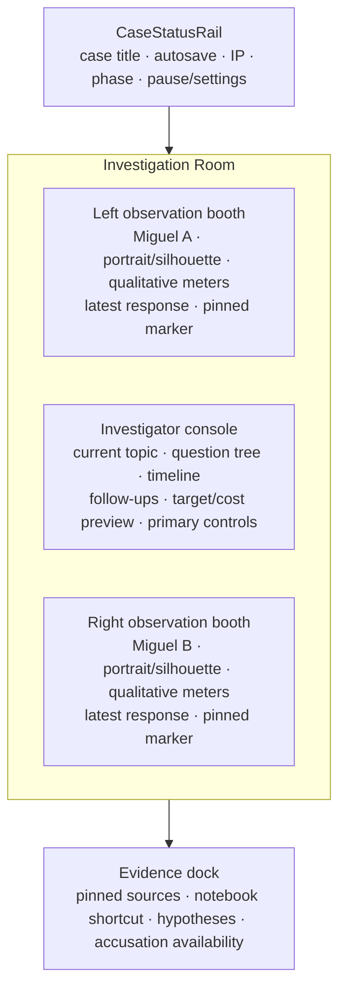

# MiguelMiguel — UI/UX and Visual Design Brief

> **Superseded:** This document describes the earlier web-game interface. Do not use it as implementation authority for the Godot visual novel. See `VISUAL_AUDIO_BRIEF.md`.

**Status:** Gates 1–3 planning draft
**Design intent:** restrained archival laboratory; deliberate, readable, psychologically tense
**Primary viewport:** desktop investigation at 1200px and above

## 1. Binding design principles

### 1. Preserve uncertainty

The interface must never teach the player that a color, side, portrait, animation, response speed, or audio cue means “real.” Subject accents identify position only. A/B assignment is randomized by the server per run. Both booths expose the same capability set, labels, and state treatments. Every semantic state is paired with text or iconography; color is never the only signal.

### 2. Turn attention into a theory

The core experience is an investigation console, not a collection of generic cards. Question costs, targets, prerequisites, unlocks, and consequences are legible before commitment. The notebook and evidence dock reduce memory load while preserving the player's uncertainty. Connections are framed as hypotheses until the server validates them.

### 3. Make the authored logic visible after commitment

The debrief is a teaching surface. It reveals the chain of facts and links that made the case solvable, distinguishes identity from guilt, and shows where the player's theory diverged. UI tension may come from pacing and language, never from hidden interaction rules or jump scares.

## 2. Visual direction

The Palinode Institute feels like a secure archive and observation laboratory: institutional records, smoked observation glass, mirrored interview booths, stamped evidence, and subtle signal corruption. The visual language should feel designed and authored rather than like a startup dashboard or neon cyberpunk template.

### Quality references

- Archival reading rooms: legible paper, restrained stamps, careful indexing, and the gravity of records.
- Observation labs: layered sightlines, mirrored subject layouts, and a controlled sense of distance.
- Industrial wayfinding: concise labels, durable dividers, and clear hierarchy under low light.
- Editorial suspense: strong composition, negative space, and typographic pacing rather than constant animation.

### Avoid

- Purple/blue gradient startup styling.
- Excessive glassmorphism or floating card mosaics.
- Glitch effects on every interaction.
- Tiny monospaced body text.
- Permanent red/green “good versus bad” coding.
- Decorative asymmetry that could imply which subject is real.
- Generic dashboard grids where a spatial investigative layout is more useful.

## 3. Design tokens

All tokens are CSS custom properties in the future frontend foundation and must be demonstrated in the component showcase. Token names are stable API-like contracts for design implementation.

```css
:root {
  /* Environment */
  --bg-void: #090D0E;
  --bg-room: #101617;
  --surface-1: #161E20;
  --surface-2: #1D282A;
  --paper: #E7E0D1;
  --ink: #161A1B;

  /* Typography */
  --text-primary: #F2EEE5;
  --text-secondary: #AAB4B5;
  --text-on-paper: #161A1B;

  /* Semantics and subject position */
  --subject-cyan: #65CBC7;
  --subject-amber: #E3AA5D;
  --signal-red: #D75D61;
  --signal-green: #77B99A;
  --focus: #F3D675;
  --border: #344144;

  /* Type */
  --font-sans: "IBM Plex Sans", system-ui, sans-serif;
  --font-mono: "IBM Plex Mono", ui-monospace, monospace;
  --text-12: 12px;
  --text-14: 14px;
  --text-16: 16px;
  --text-18: 18px;
  --text-22: 22px;
  --text-28: 28px;
  --text-36: 36px;
  --text-48: 48px;
  --leading-body: 1.55;
  --leading-tight: 1.15;

  /* Spatial rhythm */
  --space-1: 4px;
  --space-2: 8px;
  --space-3: 12px;
  --space-4: 16px;
  --space-6: 24px;
  --space-8: 32px;
  --space-12: 48px;
  --space-16: 64px;

  /* Shape, depth, motion */
  --radius-record: 2px;
  --radius-control: 6px;
  --radius-modal: 12px;
  --shadow-low: 0 4px 16px rgba(0, 0, 0, .24);
  --shadow-high: 0 18px 48px rgba(0, 0, 0, .38);
  --motion-feedback: 120ms;
  --motion-panel: 220ms;
  --motion-reveal: 400ms;
}
```

### Token usage rules

- `--paper` is reserved for archival documents, index cards, and printed records. It is not a general light theme surface.
- `--subject-cyan` and `--subject-amber` indicate left/right subject position only. Every usage includes a label or icon.
- `--signal-red` is for destructive actions, danger, and validated contradictions; it is not a fake indicator.
- `--signal-green` is for success and corroboration; it is not a real indicator.
- `--text-secondary` must pass contrast checks against each surface where it appears; if it does not, use `--text-primary` or a corrected derived token.
- IBM Plex Sans is used for headings, body, buttons, and dialogue. IBM Plex Mono is limited to case IDs, timestamps, record labels, and compact numeric data.
- Body text defaults to 16px/1.55. Minimum interactive label is 14px. Long dialogue lines should stay near 60–72 characters on desktop.
- Base unit is 4px. Controls use 6px corners, records use 2px corners, and modals use 12px corners. Avoid pill shapes except compact status tags.
- Default divider is 1px; active/focus emphasis is 2px. Focus uses a visible `--focus` ring.
- Motion is feedback at 120ms, panel transition at 220ms, and rare narrative reveal at 400ms. `prefers-reduced-motion: reduce` disables nonessential movement and replaces staged reveals with immediate state changes.

## 4. Screen inventory

1. Landing/title screen.
2. Content and tone notice.
3. Login.
4. Registration.
5. Forgot password and reset password.
6. Campaign archive/dashboard.
7. Case briefing.
8. Main interrogation room.
9. Full evidence board/notebook.
10. Evidence/document inspection overlay.
11. Pause/resume menu.
12. Final accusation builder.
13. Case debrief/result.
14. Player progress and achievements.
15. Settings and accessibility.
16. Guest-to-account upgrade.
17. Session-expired recovery.
18. Offline/reconnection state.
19. 404 safe page.
20. 500 safe error page.

## 5. Core shell and layout

### 5.1 Desktop investigation room (1200px+)

The main interrogation experience uses three spatial regions plus a top rail and bottom dock. It is not three generic cards: the central console is the working surface, while the side booths are observation windows.



- Left and right booths are mirrored in hierarchy but not literally reversed text.
- The center is 40–48% of available width; each booth is 26–30%.
- The center maintains the latest conversation context without forcing the player to scroll away from the current action.
- The bottom dock remains visible on desktop and can show a compact set of pinned sources; the full notebook opens as a dedicated surface.
- The top status rail stays stable so IP and autosave never disappear during a question.

### 5.2 Tablet (768–1199px)

- Subject panels remain side by side above the full-width investigator console.
- Evidence becomes a collapsible drawer.
- Top rail keeps case, IP, phase, and pause; secondary labels may collapse to icons with accessible names.
- Use the same content order as desktop so responsive behavior does not change meaning.

### 5.3 Mobile (<768px)

- Use a tabbed Miguel A / Questions / Miguel B interface with a sticky IP and action bar.
- Questions tab shows target, cost, question tree, timeline, and primary action.
- A compare-responses view places the two answers in a stacked, clearly labeled comparison so the player never has to memorize an answer while switching tabs.
- Evidence and notebook are full-screen drawers/routes; evidence documents use fit-width plus controlled zoom.
- No horizontal scrolling for primary content. Every interactive target is at least 44×44px.

## 6. Component library

The initial component reference should show tokens, variants, interaction states, and reduced-motion behavior. The list below is the contract for the frontend foundation.

### Shell and navigation

- `AppShell`: authenticated, guest, loading, offline, and safe-error states.
- `FacilityHeader`: wordmark, current case, account/settings controls.
- `CaseStatusRail`: case ID/title, autosave status, IP remaining, phase, pause/settings.
- `EvidenceDock`: pinned item strip, notebook shortcut, hypotheses, accusation action.
- `Drawer`, `Modal`, `Toast`, `ConfirmDialog`.

### Investigation

- `SubjectBooth`: neutral/cyan/amber position treatment; calm/guarded/strained/volatile states; selected/mentioned/updated markers.
- `SubjectPortrait`: silhouette or restrained portrait crop; loading and unavailable fallback; never identity-coded.
- `StateIndicator`: text + icon + optional meter label, never exact values in the UI.
- `DialogueBubble`: statement, refusal, recollection, challenged, and redacted variants.
- `QuestionTree`: topic, locked, available, selected, follow-up, spent, and cost-preview states.
- `ActionPreview`: target, IP cost, expected consequence class, confirm/cancel.
- `AnswerPair`: both answers, comparable order, new-unlock announcement, pin action.
- `ConversationTimeline`: chronological and filterable by subject/source.
- `UnlockNotice`: follow-up/evidence unlock with explicit “new” semantics and focus management.
- `PressureControl`: challenge/present evidence/high-pressure question; destructive confirmation when appropriate.

### Evidence and reasoning

- `EvidenceCard`: record/object/recording/witness variants; locked, available, examined, pinned.
- `EvidenceViewer`: document/object/recording/witness layout; zoom and transcript controls.
- `NotebookPanel`: notes, pins, suspicion estimates, and sources.
- `ConnectionComposer`: two-source selector, connection type, hypothesis/validated/rejected result.
- `SuspicionControl`: private estimate with neutral labels and accessible range input; never exposes official truth.
- `CostBadge`: IP cost with text and icon; never uses color alone.

### Outcome and account

- `AccusationBuilder`: conclusion, citations, strategy, confidence, review, irreversible confirmation.
- `ScoreBreakdown`: category values, grade, hint penalty, missed clues, and false assumptions.
- `DebriefStep`: authored solution chain and player comparison.
- `ArchiveCaseRow`, `ProgressSummary`, `AchievementTile`.
- `AuthForm`, `GuestUpgradeForm`, `SessionRecovery`, `SettingsForm`.

## 7. Screen-by-screen hierarchy and primary actions

### Landing/title

1. Wordmark and premise.
2. Short hook: “Two memories. One name. No certain original.”
3. Primary action: Play as Guest.
4. Secondary actions: Login, Register, settings/accessibility.
5. Tone notice link.

Loading state presents the title and a restrained progress message. Error state provides retry and support-safe diagnostic ID. No case identity data appears.

### Campaign archive

1. Facility header and account/guest status.
2. Progress summary.
3. Five ordered case rows with status, completion, grade, best score, and action.
4. Achievements shortcut.

Empty state for a new player points to Case 1. Locked state names the required prior completion but not private future content. Loading uses structural row placeholders; error preserves cached public progress only if it is clearly labeled stale.

### Case briefing

1. Case ID and title.
2. Verified public record and incident summary on archival paper surface.
3. Objective and allowed outcomes.
4. Starting IP and action glossary.
5. Primary action: Begin examination.

The briefing must make the cost model legible without becoming a manual. A back action returns to archive without creating a run.

### Interrogation room

1. Persistent status rail.
2. Side subject booths with latest response and qualitative states.
3. Center current topic/question tree and action preview.
4. Response timeline and new unlock announcement.
5. Evidence dock and accusation availability.

Primary action changes with state: Ask question, Examine evidence, Challenge, or Open accusation. Paid actions always show target and cost before execution. After an answer, focus moves to the new response or unlock announcement—not automatically into a different question.

### Evidence viewer

1. Evidence title, source type, and examined status.
2. Document/object/recording/witness content.
3. Pin and note actions.
4. Close/return to interrogation.

Document content uses `--paper` and `--ink`; system labels use IBM Plex Mono sparingly. On mobile, fit-width is the default and zoom is controlled, not free-scrolling beyond the viewport.

### Notebook/evidence board

1. Pinned sources.
2. Notes and annotations.
3. Suspicion estimates.
4. Connection composer and list of hypotheses/validated links.

The empty state explains that pinning and notes are free and do not reveal correctness. Invalid connections are labeled rejected only after the server evaluates them; the explanation remains bounded so it does not leak other hidden links.

### Accusation builder

1. State and IP summary.
2. Conclusion choices.
3. Two-or-three source citation control.
4. Copy-strategy selection.
5. Confidence selection.
6. Review consequence panel.
7. Primary action: Confirm irreversible submission.

The final confirmation must summarize the choices in plain language. Validation errors are local and specific. After success, the builder is immutable.

### Debrief/result

1. Outcome and grade.
2. Score breakdown.
3. Stepwise authored solution.
4. Player citations and validated/rejected links.
5. Missed evidence and false assumptions.
6. Next case / return to archive.

Debrief content is progressive: show one step at a time with an accessible “continue” control, but provide “view all steps” for players who prefer a summary. Reduced motion shows all steps in the same order without staged animation.

### Settings/accessibility

Controls include reduced motion, high contrast, text size where feasible, sound/mute if audio is later added, and logout/account actions. Settings are account-scoped when authenticated and locally remembered only for non-sensitive presentation preferences when guest.

## 8. Core interaction flow

```mermaid
sequenceDiagram
  participant P as Player
  participant UI as Investigation UI
  participant API as Authoritative API
  participant DB as Run transaction
  P->>UI: Choose topic/question
  UI-->>P: Show target, IP cost, prerequisites
  P->>UI: Confirm action
  UI->>API: Idempotency-Key + expected state_version
  API->>DB: Lock run, validate, spend IP, apply authored deltas
  DB-->>API: New state + public answer projection
  API-->>UI: Answer pair, unlocks, state_version, autosave status
  UI-->>P: Announce response/unlocks; preserve focus
  P->>UI: Pin, note, connect, or accuse
```

Connection and notebook actions do not spend IP. Paid actions always require a server round trip and safe retry behavior. The client may retain an unsent note draft locally, but the server remains authoritative for game state.

## 9. Content and copy style

- Precise, restrained, observational prose; avoid melodrama.
- Short question labels; full authored text appears in the preview and transcript.
- Use plain text narrative in MVP. Rich text is not required and should not be introduced casually.
- Maintain future localization keys for every narrative and interface string; never concatenate player-facing strings from arbitrary fragments where a translator would need sentence-level context.
- Dialogue can feel tense or evasive, but do not equate confidence, emotionality, or refusal with authenticity.
- System feedback explains the action outcome (“1 IP spent. Follow-up unlocked.”) without editorializing about who seems real.

## 10. Accessibility and verification plan

- WCAG 2.2 AA target for core journey.
- Full keyboard path: landing → guest → briefing → question → response → notebook → accusation → debrief.
- Visible focus ring using `--focus`; no focus traps except intentionally modal content.
- Semantic headings and landmarks for rail, booths, console, evidence dock, and dialogs.
- ARIA labels announce subject position, qualitative state, target, cost, and new unlocks.
- Color contrast checks for every token pair used in text or controls.
- Screen reader output distinguishes Miguel A and Miguel B by label, not color alone.
- Touch targets minimum 44×44px.
- Reduced-motion mode verified on all panel transitions, response reveals, and debrief steps.
- High-contrast mode verified for borders, selected states, disabled states, and paper surfaces.
- Manual checks: keyboard-only, NVDA/VoiceOver smoke path, 200% zoom, mobile 320px width, long dialogue, long evidence title, empty notebook, offline banner.

## 11. Loading, empty, error, success, and offline contract

| Surface | Loading | Empty | Error | Success/offline |
| --- | --- | --- | --- | --- |
| Archive | Structural case-row placeholders | “Begin with Case 1” | Retry with safe error ID | Stale cache labeled; sync indicator |
| Briefing | Record skeleton | Not expected | Return to archive/retry | Begin confirmation |
| Interrogation | Preserve last stable answer and disable paid action | Fresh run with initial statement prompt | Retry/reload authoritative state | Autosave acknowledged; offline blocks paid actions |
| Evidence | Viewer skeleton | No extra evidence state | Retry without losing pins/notes | Examined status and pin available |
| Notebook | Section skeleton | Explain free note/pin actions | Local draft recovery | Saved timestamp and validation badge |
| Accusation | Step skeleton | Explain required citations | Field-level errors; no partial submission | Immutable result and debrief link |
| Debrief | Step skeleton | Not expected | Retry; do not reveal private data | Result stored and progression updated |
| Auth | Form skeleton | Not applicable | Safe field-level message | Session status and redirect |

Offline mode is read-only for the current public state. The UI may retain draft notes locally, but it does not pretend paid actions succeeded. Reconnection reloads the authoritative run and reports what was restored.

## 12. Design review gate

Before application code begins, approve:

- Desktop, tablet, and mobile wireframe relationships above.
- Neutral treatment of subject identity and color semantics.
- Token names and typography constraints.
- Component state inventory and accessibility commitments.
- Accusation/debrief separation between factual score and philosophical epilogue.
