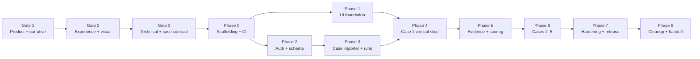

# MiguelMiguel — Milestone Plan

> **Superseded:** This document describes the earlier web-game implementation plan. Do not use it as implementation authority for the Godot visual novel. See `PRODUCTION_MILESTONES.md`.

**Status:** Gates 1–3 planning draft
**Delivery style:** vertical, reviewable slices; each phase ends with checks, changed-file summary, behavior summary, and remaining risk

## 1. Approval gates

### Gate 1 — Product and narrative

**Deliverables:** PRD, persona alignment, MVP/non-goal boundary, five case spines, score model, open questions.
**Exit:** product/narrative approval; no scope ambiguity that changes the loop or case premise.

### Gate 2 — Experience and visual system

**Deliverables:** design tokens, investigation-room layout, screen inventory, component states, responsive rules, accessibility requirements, wireframes.
**Exit:** design approval; no subject-side visual cue can be mistaken for identity truth.

### Gate 3 — Technical and case contract

**Deliverables:** architecture, ER diagram, public/private projection rules, API inventory, idempotency/concurrency model, case schema, threat model, test strategy.
**Exit:** technical/security/narrative approval before application code.

This repository slice completes the documents for these gates. Per the product brief, implementation stops here until approval.

## 2. Implementation phases

### Phase 0 — Monorepo and CI foundation

**Scope:** React/TypeScript web shell, FastAPI API shell, package management, formatting/lint/typechecking, Docker Compose, `.env.example`, environment validation, PostgreSQL/Redis connectivity, health endpoints, pull-request CI.

**Checks:** clean build, migration runner connection, `/health/live`, `/health/ready`, CI green.
**Risk:** deployment target and email adapter remain provisional.

### Phase 1 — Token-driven frontend foundation

**Scope:** AppShell, FacilityHeader, status rail, tokens, font loading, component showcase, responsive skeletons, safe loading/error/offline states.

**Checks:** component tests, keyboard smoke path, contrast audit, reduced-motion behavior at desktop/tablet/mobile viewports.
**Risk:** no game data yet; use stable fixtures.

### Phase 2 — Auth, guest ownership, database schema

**Scope:** migrations, users/sessions/guests, registration/login/logout/reset, secure sessions, CSRF, guest conversion, progress entities, centralized ownership.

**Checks:** integration authorization matrix, session lifecycle, rate-limit tests, migration/seed smoke.
**Risk:** email provider contract must be finalized before production reset flow.

### Phase 3 — Case schema, importer, and run creation

**Scope:** strict case JSON/Pydantic schema, import/seed validation, case versioning, campaign archive, briefing, server-side run creation, secure A/B assignment, public projections.

**Checks:** all five planning definitions validate; no private fields in public schemas; role assignment tests; case retirement test.
**Risk:** authored content is still provisional until independent solvability review.

### Phase 4 — Case engine and Case 1 vertical slice

**Scope:** question/action state machine, IP, prerequisites, state meters, follow-ups, unlocks, idempotency, optimistic concurrency, Case 1 complete content, engine tests, landing/archive/briefing/interrogation UI.

**Checks:** Case 1 playable from briefing through debrief; refresh/retry/two-tab tests; at least two independent solve paths; tutorial usability pass.
**Risk:** balance and reading time need playtest evidence.

### Phase 5 — Evidence, notebook, reasoning, and outcome

**Scope:** evidence dock/viewer, examination, notebook/autosave/recovery, pins, suspicion estimates, connection graph, pressure/challenges/hints, accusation builder, server scoring, debrief, progression, achievements.

**Checks:** evidence connections validate/reject safely; score rubric table tests; accusation immutability; debrief gating; mobile compare responses; accessibility journey.
**Risk:** reasoning-score tuning may require additional authored diagnostics.

### Phase 6 — Cases 2–5, one at a time

For each case:

1. Complete bible, truth/public timelines, knowledge maps, question tree, evidence register, solution graph, scoring rubric, debrief.
2. Validate schema/reachability/hidden data.
3. Independent reviewer solves from a clean run.
4. Implement and balance IP/hints.
5. Add table-driven engine/API/E2E coverage.
6. Review narrative continuity and sensitivity.

**Checks:** no case is marked complete until the reviewer can solve it from available evidence and the debrief explains wrong-but-reasoned theories.

### Phase 7 — Hardening and release readiness

**Scope:** performance optimization, route splitting, responsive QA, accessibility audit, offline/session recovery, security controls, production deployment docs, approved Playwright suite, backups/restore guidance.

**Checks:** LCP/INP targets, security audit, full CI, production build/deploy smoke, no Critical/High findings.
**Risk:** external provider, hosting, and backup configuration are environment-specific.

### Phase 8 — Cleanup audit and final handoff

**Scope:** read-only cleanup audit first; report unused files/imports/dependencies/env/routes, duplication, oversized files, and deletion risk. Apply only approved cleanup; preserve behavior.

**Checks:** full validation suite, staged/unstaged diff review, commit organization, README/setup/deployment/case-authoring inventory, known issues and deferred scope.

## 3. Phase review format

At the end of every implementation phase, report:

```text
Phase:
Changed files:
New behavior:
Checks run and results:
Known risks:
Deferred decisions:
Next approval needed:
```

Each phase must leave the repository buildable and tests passing. Behavior changes, refactors, tests, docs, CI, and migrations should remain separate commits when that preserves a coherent passing sequence. The user-requested remote workflow currently requires each completed change to be committed and pushed.

## 4. Dependency order



## 5. Approval request after this slice

Please approve or revise the following before application code begins:

- the five case spines and their learning progression;
- the three-region investigation layout and subject-neutral visual semantics;
- the public/private projection boundary;
- the case-definition contract and independent solvability review;
- the threat/test priorities and open-question defaults in `PRD.md`.
