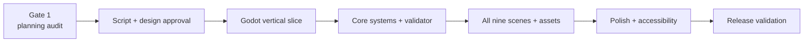

# MiguelMiguel — Production Milestones and Risks

**Status:** Gate 1 planning authority
**Approach:** approve narrative and design before engine work; build a small playable slice before integrating all content

## 1. Milestones

### Milestone 0 — Gate 1 planning audit

**Deliverables:** game bible, narrative design, beat sheet, truth timeline, knowledge table, choice/profile matrix, visual/audio brief, technical design, milestones/risks.
**Exit:** user approves canon, scope, viewpoint, choice matrix, endings, and normal-folder-first workflow.
**Current state:** documents prepared; awaiting approval.

### Milestone 1 — Script and content lock

**Work:** finalize names/terminology, draft `docs/SCRIPT.md` in scene order, author node IDs, dialogue, choices, profile entries, conditional variants, asset/audio cues, and endings.

**Checks:** read the script aloud; audit word count, pacing, exposition, repeated philosophy, false-choice wording, factual consistency, impossible knowledge, and identity-coded behavior.
**Exit:** script approval before full implementation.

### Milestone 2 — Godot project and vertical slice

**Work:** create the Godot project, title screen, story UI, deterministic dialogue runner, one background, clearly labeled placeholder portraits, Scene 1 through Choice 1, profile overlay, basic settings, autosave/manual save.

**Success criterion:** a new tester can play ten minutes without developer explanation.
**Checks:** story runner smoke test, save/load at Scene 1 boundary, keyboard focus, text speed, reduced motion, Windows debug run.

### Milestone 3 — Core systems

**Work:** all dialogue node types, dossier viewer, conditional lines, final report and routing, examiner profile assembly, dialogue history, auto, skip, accessibility controls, and story validator.

**Checks:** every node type renders; all four endings reachable; no branch strands the player; saved choices remain stable.

### Milestone 4 — Content integration

**Work:** integrate Scenes 2–9, final approved script, final backgrounds/portraits/music/effects, dossier items, profile variants, and report consequences.

**Checks:** all six choices appear exactly once; all four endings work; no factual contradiction; profile entries assemble as authored; visual treatment never reveals origin.

### Milestone 5 — Polish and accessibility

**Work:** pacing cuts, silence and audio balance, UI focus, text scaling, reduced motion, high-contrast checks, save interruption recovery, history/auto/skip polish, credits and license records.

**Checks:** fresh-player test, keyboard-only critical path, manual accessibility matrix, clean-machine Windows run.

### Milestone 6 — Release validation

**Work:** Windows export, optional web export evaluation, README/setup/controls/export notes, story graph validation, save tests, asset/license audit, screenshots and release package.

**Exit:** first-time player completes in 45–60 minutes; factual original is discoverable without visual meta-clues; moral question remains legitimately unresolved; all four endings are reachable and distinct; no backend/telemetry/secret/online dependency exists.

## 2. Gate dependencies

The project should not skip from planning directly to full content integration. The vertical slice proves the UI, data shape, input, saves, and tone before the remaining story is expensive to build.

## 3. Risk register

Risk terms: **severity** means how damaging the failure would be; **likelihood** means how likely it is without mitigation; **owner** is the role that should decide or fix it.

| Risk | Severity | Likelihood | Mitigation | Owner/decision |
| --- | --- | --- | --- | --- |
| Script exceeds 10,000 words or feels lecture-like | High | Medium | Hold scenes near lower-middle budgets; read aloud; cut repeated philosophy | Narrative review |
| Player cannot understand the factual answer | High | Medium | Seed concrete evidence, keep marker reveal legible, test with fresh players | Narrative + QA |
| Player reads anger/calmness as origin proof | High | Medium | Explicit neutral entries, symmetric portraits, review all conditional lines | Narrative + visual |
| B becomes obviously “the good one” | High | Medium | Preserve agency uncertainty; keep A understandable and B fallible | Narrative review |
| A becomes a villain instead of morally compromised | High | Medium | Show his political grievance and personal wound beside the worker risk | Narrative review |
| No Signature feels like a reward for doing nothing | High | Medium | Show emergency authorization and Elias’s continued consequence | Game direction |
| Branches become a large route tree | Medium | Medium | Use branch-and-bottleneck structure and authored variants only | Engineering + narrative |
| Six choices feel like a personality quiz | Medium | Medium | Use evidence-record language, no scores, no correct feedback, immediate profile notes | Narrative + UX |
| Save/load loses a choice or strands the story | Critical | Medium | Versioned schema, scene-boundary round trips, corrupt-save recovery tests | Engineering + QA |
| Story data contains missing node or asset references | High | Medium | Headless validator in development and CI before export | Engineering |
| Placeholder art is mistaken for final | Medium | High early | Prefix/label placeholders and maintain manifest replacement status | Production |
| Art direction accidentally codes A/B identity | High | Medium | Same visual capability set, neutral color semantics, visual QA with blinded reviewers | Art + narrative |
| Audio becomes repetitive or over-explains emotion | Medium | Medium | Separate buses, restrained motifs, silence budget, fresh-player audio pass | Audio + direction |
| Godot version/plugin incompatibility | Medium | Low | Pin 4.7-compatible version; avoid third-party plugins in first slice | Engineering |
| Web export causes text, save, or accessibility regression | Medium | Medium | Treat web as optional after Windows acceptance; do not let it delay desktop | Technical approval |
| Missing named full-plan file causes conflicting canon | High | Medium | Compare any supplied file before script work; use current Gate 1 documents as authority meanwhile | User approval |
| Licensing gap in commissioned or temporary assets | High | Medium | Asset manifest records source/license/replacement; no final packaging without audit | Production |

## 4. Risk review cadence

At each milestone, review the top five risks and record:

- what changed;
- whether likelihood increased or decreased;
- which check produced evidence;
- whether the risk is accepted, mitigated, or blocking;
- whether user approval is needed before continuing.

Do not solve a narrative risk with an unreviewed technical feature. Do not solve a save risk by quietly discarding player progress.

## 5. Definition of done

- First-time completion is approximately 45–60 minutes.
- Opening feels procedural before becoming philosophical.
- Biological continuity is discoverable from evidence, not visual meta-clues.
- Six profile choices are meaningful and reflected in the examiner profile.
- Four endings work and none is labeled correct.
- Save/load, history, auto, skip, settings, audio controls, keyboard navigation, and reduced motion work.
- Story validator and tests pass.
- Windows export runs on a clean machine.
- Assets and licenses are documented.
- README explains setup, controls, structure, tests, and export.
- No backend, telemetry, secret, or unnecessary online dependency exists.
