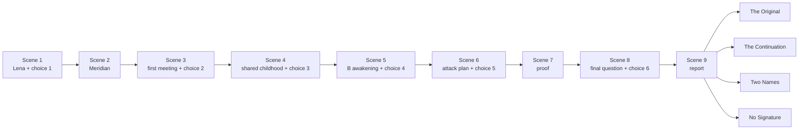

# MiguelMiguel — Scene-by-Scene Beat Sheet

**Status:** Gate 1 planning authority
**Structure:** nine major scenes, branch-and-bottleneck
**Target:** 45–60 minutes; 8,000–10,000 words on a first playthrough

## 1. Budget note

The supplied direction gives scene envelopes that total close to the upper script target before all four ending variants are considered. Treat the ranges below as planning envelopes, not a requirement to hit every maximum. The script edit should target approximately 8,800–9,600 words on one first-playthrough path, with shared report setup plus one ending variant. Unchosen ending text may exist outside the first-playthrough count.

| Scene | Title | Location | Target time | Planning envelope |
| ---: | --- | --- | ---: | ---: |
| 1 | A Minor Irregularity | Civic Investigations office | 6–8 min | 800–1,000 |
| 2 | Meridian, 18:40 | Train and city exterior | 4–5 min | 600–800 |
| 3 | Miguel / Miguel | Split interrogation room | 7 min | 1,000–1,200 |
| 4 | A Shared Childhood | Interrogation room + memory image | 8 min | 1,200–1,400 |
| 5 | The First New Memory | Interrogation room | 8 min | 1,200–1,500 |
| 6 | Necessary Casualties | Records-plan review/interrogation | 8–9 min | 1,300–1,500 |
| 7 | Proof | Lab report/office/corridor | 4–5 min | 700–900 |
| 8 | One Final Question | Split interrogation room | 4–5 min | 600–800 |
| 9 | The Signature | Records/profile surface | 5–8 min + ending | 500–700 + one 250–400 ending |

**Budget risk:** if every scene reaches its maximum and all endings are counted together, the manuscript exceeds 10,000 words. Hold most scenes near the lower-middle of their range and keep ending variants concise.

## 2. Beat sheet

### Scene 1 — A Minor Irregularity

**Purpose:** begin as a human detective story; teach the player that factual guilt and moral judgment are separate.
**Location:** Civic Investigations interview office, late afternoon.
**Word/time:** 800–1,000 words / 6–8 minutes.
**Profile choice:** Choice 1, Lena’s motive.

**Beats:**

1. Elias returns to a solved case instead of leaving on time.
2. The Measure has reconstructed Lena’s identity-allowance transaction; the facts are uncontested.
3. Lena admits selling access to part of her allowance to buy medicine for someone dependent on her.
4. Elias notices the procedural language has no field for need, care, or coercion.
5. Lena refuses to plead for sympathy. Keep her language plain: she asks Elias to attach her recorded statement to the appeal rather than asking him to forgive her.
6. The player classifies her motive through the official interpretation overlay.
7. The Measure’s report remains unchanged; Elias signs it.
8. A pen/signature sound establishes the audio motif reused in Scene 9.

**Choice options:** deliberate financial fraud; coercion by material necessity; protective responsibility; insufficient information.
**Exit:** Mara Hale’s dossier arrives; Elias is ordered to the detention facility.

### Scene 2 — Meridian, 18:40

**Purpose:** establish the city through ordinary observation and assign the central case.
**Location:** automated train and Meridian exterior.
**Word/time:** 600–800 words / 4–5 minutes.

**Beats:**

1. Elias boards an on-time train and opens a follow-up message from Lena asking him to attach her recorded statement to her appeal before her medicine exception expires.
2. A reskilling advertisement promotes a profession already automated.
3. An unemployment queue stands under a luxury storefront advertising “made by human hands.”
4. A public screen reports improved allocation efficiency.
5. A small exchange between passengers shows ordinary life continuing around administrative harm.
6. Hale sends the dossier: two prisoners, one legal citizen, one institutional construct, one hour for designation.
7. Elias reads the word *duplicate* and does not yet ask what the report will authorize.

**Exit:** Elias attaches Lena’s statement to the appeal, then the train doors open at the detention facility; the building is quiet rather than theatrical.

### Scene 3 — MiguelMiguel

**Purpose:** introduce the pair and establish that affect is not identity evidence.
**Location:** split interrogation room.
**Word/time:** 1,000–1,200 words / about 7 minutes.
**Profile choice:** Choice 2, interpretation of behavior.

**Beats:**

1. A and B object to the labels but use them because the institution requires them.
2. Both give nearly identical accounts of Miguel’s childhood, work, father, and rebellion.
3. A is openly hostile; B is controlled and precise.
4. Elias observes the difference but records that presentation is not proof.
5. Both Miguels recognize that Elias signs automated conclusions.
6. A asks whether Elias is investigating them or authorizing what happens afterward.
7. B watches Elias’s pen rather than Elias’s face.
8. The player classifies the observable behavior without converting it into an origin claim.

**Choice options:** A’s anger suggests personal violation; A’s anger suggests strategic intimidation; B’s calm suggests emotional distance; B’s calm suggests disciplined fear; behavior cannot establish origin.
**Exit:** Mara Hale interrupts through the room system and orders Elias to proceed to shared childhood evidence.

### Scene 4 — A Shared Childhood

**Purpose:** prove that memory can match while meaning changes.
**Location:** interrogation room with a shared-memory visual of a repaired mechanical bird or obsolete radio.
**Word/time:** 1,200–1,400 words / about 8 minutes.
**Profile choice:** Choice 3, Miguel’s original motive.

**Beats:**

1. Elias asks about Miguel’s father and the repaired object.
2. A and B recall the same solder smell, object damage, room layout, and father’s statement that usefulness is not worth.
3. The matching details make the institution’s duplication claim more plausible without proving everything else.
4. A interprets the father’s patience as surrender.
5. B interprets it as evidence that dignity can survive uselessness.
6. Elias sees that memory content has not changed, but present meaning has.
7. The player classifies Miguel’s original motive for joining the Measure.
8. One profile entry records what Elias trusts: reform, status, fear, loyalty, or restraint about motive.

**Choice options:** belief in fair reform; desire for status; fear of becoming economically irrelevant; loyalty to his father; mixed/insufficient motive.
**Exit:** B asks Elias about the first memory that belongs only to B.

### Scene 5 — The First New Memory

**Purpose:** make B sympathetic without proving that his agency is free.
**Location:** interrogation room, with the first independent-memory presentation.
**Word/time:** 1,200–1,500 words / about 8 minutes.
**Profile choice:** Choice 4, B’s agency.

**Beats:**

1. B describes waking inside the institution after the reconstruction snapshot.
2. The institution gave him Miguel’s hatred and expected him to defend the Measure.
3. B revealed his origin to part of the Uncounted instead.
4. A argues that B’s revolt may have been predicted, contained, or programmed.
5. B asks whether A chose the grief and humiliation that shaped his own rebellion.
6. Elias recognizes that unchosen causes do not automatically erase responsibility.
7. The player classifies B’s agency.
8. The scene refuses a secret code, medical scan, or later reveal that would settle the question.

**Choice options:** programmed behavioral deviation; genuine moral choice; continuation of Miguel’s existing values; agency cannot be inferred from origin.
**Exit:** Mara Hale supplies the records-facility plan.

### Scene 6 — Necessary Casualties

**Purpose:** create a concrete moral divergence without making either subject a thesis machine.
**Location:** interrogation room with records-plan dossier and evidence surface.
**Word/time:** 1,300–1,500 words / 8–9 minutes.
**Profile choice:** Choice 5, classification of A’s act.

**Beats:**

1. Elias reviews the attack plan and the night-worker roster.
2. Evidence establishes that A knew workers remained inside and understood that refusing to cancel could kill them.
3. A argues that workers maintained a system whose slow administrative deaths remain invisible; he chooses possible systemic change over immediate lives.
4. B agrees about the system but rejects making replaceable workers carry the guilt of its owners.
5. B discovers the plan before the detonation and knows the institution-controlled emergency channel is monitored and may expose the Uncounted’s access route.
6. B uses the channel anyway. The workers escape, but the warning disrupts timing rather than stopping the attack: the archive is partially destroyed, the Measure continues, authorities capture rebels, and most of the copied evidence is destroyed.
7. A calls B’s rescue a form of institutional conditioning; B admits he cannot prove that his compassion was free.
8. The player classifies A’s act.
9. No option shames the player; the scene leaves silence after the selection.

**Choice options:** terrorism; politically necessary sabotage; morally compromised resistance; retaliation disguised as justice; insufficient context for moral classification.
**Exit:** Hale authorizes the laboratory report, and Elias is left with a provisional private assessment before he reads it.

### Provisional deduction — Private Assessment

This is a deduction, not a seventh profiling choice. It does not change history, profile axes, ending access, or final score.

**Prompt:** “Before reviewing the laboratory result, which subject do you currently believe is biologically original?”

**Options:** Miguel A; Miguel B; Available evidence is insufficient.

Record the answer privately. After the marker appears in Scene 7, Elias briefly reflects on whether his inference matched the report and what kind of evidence he was relying on. The reflection must not praise a correct guess or shame an incorrect one.

### Scene 7 — Proof

**Purpose:** reveal the factual result and expose the institutional use of Elias.
**Location:** lab report/profile surface, then office or corridor.
**Word/time:** 700–900 words / 4–5 minutes.

**Beats:**

1. The report identifies B as synthetic through a microscopic reconstruction marker.
2. Elias knows A is biologically continuous with the man born as Miguel.
3. Hale admits the Measure already knew before the interview.
4. The marker is scientifically conclusive but not legally self-executing. Elias’s signed designation creates a presumptive legal identity for the immediate proceeding and authorizes transfer.
5. A designation contradicting the marker is provisionally honored, then triggers delayed conflict review. B would temporarily receive the human-prosecution protections of the signed designation while A’s transfer is held; Hale investigates Elias because the report conflicts with conclusive evidence.
6. Refusal triggers a documented emergency review or panel override. The institution can still proceed, but it loses the clean human authorization it wanted; Elias remains useful as an auditable human refusal and accountable witness to the gap.
7. Hale says: “The system can establish continuity. It cannot assume responsibility for what continuity means.”
8. A or B delivers the central accusation: “It does not need you to know who I am. It needs you to agree with what it will do.”
9. Elias sees that the interview was not a search for truth but a request for authorization.

**Exit:** Elias is offered one final question.

### Scene 8 — One Final Question

**Purpose:** let the player choose what question Elias believes can still matter after the factual answer is known.
**Location:** split interrogation room.
**Word/time:** 600–800 words / 4–5 minutes.
**Profile choice:** Choice 6, identity criterion.

**Beats:**

1. Elias may ask one final question: which should live; what makes either Miguel; regret the failed attack; what would you choose in my position; remain silent.
2. A and B answer in authored variants shaped by earlier profile choices.
3. “Remain silent” is a deliberate action, not a shortcut; the silence is recorded.
4. The player records Elias’s criterion for identity before the report.
5. The UI offers no hint about which criterion will produce a satisfying ending.
6. The profile overlay records the sixth observation.

**Choice options:** bodily continuity; psychological continuity; present moral agency; relationships and recognition; no single criterion is sufficient.
**Exit:** the report screen opens; no countdown appears.

### Scene 9 — The Signature

**Purpose:** convert interpretation into an institutional action and assemble Elias’s profile.
**Location:** records/profile surface.
**Word/time:** 500–700 words shared report setup plus one 250–400-word ending / 5–8 minutes.

**Beats:**

1. The report shows the known biological result and the available legal actions, including the presumptive effect of a signed designation, delayed conflict review for contradiction, and emergency review after refusal.
2. The player selects one of four complete reports.
3. Each report states its consequence plainly before confirmation.
4. Reuse the pen/signature sound from Scene 1; for No Signature, let the missing sound create pressure.
5. The ending presents 2–4 minutes of consequence and profile-dependent reflection.
6. The heading changes from `SUBJECT: MIGUEL` to `SUBJECT: ELIAS VENN`.
7. The profile shows 4–6 authored observations: identity/evidence, responsibility, institution, uncertainty/avoidance, and a final-report observation.
8. End with: “Would you accept being judged by the method you used?”

**Report options:** The Original; The Continuation; Two Names; No Signature.
**Exit:** ending profile, credits, return-to-title option.

### Ending consequence beats

- **The Original:** Elias signs A’s designation. A is prosecuted and B is transferred toward reclamation under the presumptive identity. No conflict review is opened because the report agrees with the marker. Elias keeps his job and the housing/treatment priority attached to civic employment.
- **The Continuation:** Elias signs for B despite the marker. B temporarily receives human-prosecution protections and A’s transfer is held while delayed conflict review begins. Hale investigates Elias; the review can overturn the presumption. B is not instantly safe, and Elias has moved another man’s historical guilt onto him.
- **Two Names:** Elias files a noncompliant report. It is rejected; no third legal identity is created. Elias is removed, documented review begins, and both subjects’ immediate treatment remains uncertain while the institution lacks a clean designation.
- **No Signature:** Elias refuses. The institution records the refusal and uses the emergency panel override to apply the Measure’s result. A is prosecuted and B is reclaimed; Elias loses clean authorship, but the outcome still proceeds and his refusal remains in his employment record.

## 3. Branch map

The choice branches should converge at the next major scene. Later line variants should be authored, not generated at runtime.
