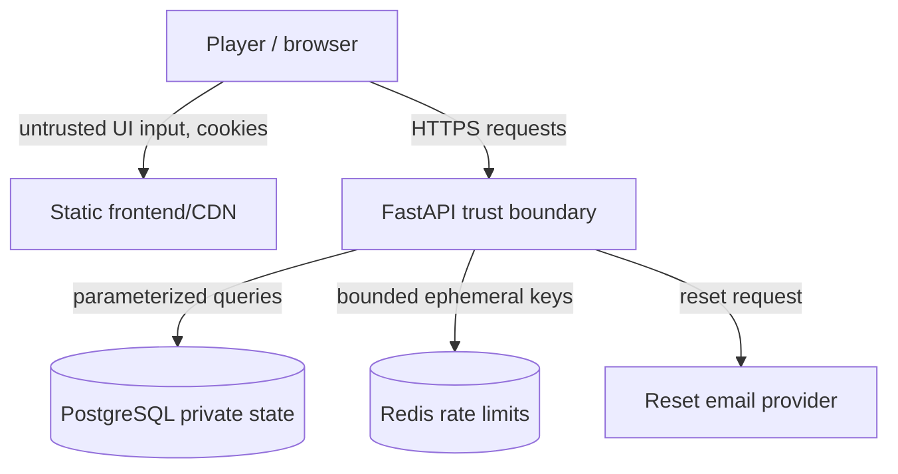

# MiguelMiguel — Threat Model

**Status:** Gates 1–3 planning draft; implementation audit happens after the feature slice
**Assets:** account ownership, guest runs, private case solutions, run integrity, player notes, reset/session secrets, progress and scores

## 1. Security objectives

1. A player can access only their own account/guest data and authorized public case projection.
2. The browser cannot obtain hidden subject roles, private profiles, or solution graphs before accusation.
3. Paid actions, IP, unlocks, state transitions, scores, and progression cannot be forged, duplicated, or rolled back through replay/concurrency.
4. Authentication sessions and reset flows resist theft, fixation, brute force, CSRF, and token replay.
5. Narrative notes and operational logs avoid unnecessary sensitive data retention.
6. Published case versions remain immutable for active runs.

## 2. Trust boundaries

The browser, client draft state, URL parameters, headers, and all request bodies are untrusted. PostgreSQL is authoritative for persistent game state. Redis is not authoritative for IP or completion. Case-definition import is trusted administrative input but remains schema-validated and immutable after publication.

## 3. Threat register and planned controls

| ID | Threat | Severity | Control | Verification |
| --- | --- | --- | --- | --- |
| T1 | IDOR: attacker changes a run UUID to read another player's run/debrief | Critical | Central owner scope on every run query; verified account/guest owner context | Cross-user API tests for GET and mutation routes |
| T2 | Hidden solution exposure in frontend bundle, API payload, or source map | Critical | Private case definitions server-only; explicit public projection schemas; contract tests scan responses/bundle | Pre-accusation response and artifact scan |
| T3 | Replay/concurrency duplicates IP spend or accusation | High | Row lock/transaction, unique idempotency key, payload hash, state version | Two-tab, timeout-after-commit, replay integration tests |
| T4 | Forged client conclusion, role, score, delta, unlock, or IP | High | Derive all sensitive fields from case engine/server state; reject client authority fields | Tampered payload test suite |
| T5 | Guest credential theft or cross-guest claim | High | Opaque expiring credential, hash at rest, owner scope, one-time transactional claim, invalidation | Guest ownership/claim tests |
| T6 | Session theft/fixation or stale session after login | High | HttpOnly/Secure cookie, SameSite, rotation on login/claim, expiry/revocation, no localStorage tokens | Session lifecycle tests and cookie inspection |
| T7 | CSRF on state-changing cookie requests | High | CSRF token/origin checks and SameSite cookie policy | Missing/invalid CSRF tests |
| T8 | Password reset account enumeration or token replay | High | Generic response, hashed single-use expiring token, rate limits, session rotation | Reset behavior tests |
| T9 | Brute-force login/reset/guest abuse | Medium | Redis-backed rate limits by account/IP/device dimensions; bounded request body | Rate-limit integration tests |
| T10 | XSS from notes or narrative content | High | React escaping, plain text narrative, strict CSP, bounded note length | Component/API payload tests and CSP review |
| T11 | SQL injection or unsafe query construction | High | SQLAlchemy parameterized queries, no string-built SQL, validated IDs | Static review and injection tests |
| T12 | CORS misconfiguration enables credential theft | High | Exact production origin allowlist; no wildcard with credentials | Header/config tests |
| T13 | Sensitive logs expose notes, reset tokens, sessions, or solutions | Medium | Structured safe metadata only; redaction policy; retention limits | Log fixture review and security audit |
| T14 | Case version mutation changes active run logic | Medium | Immutable published version referenced by run; append-only migration rule | Migration and retirement test |
| T15 | Client-side source maps reveal private case content | High | Exclude or sanitize source maps; never import private definitions into web bundle | Production artifact scan |
| T16 | Unbounded input causes resource exhaustion | Medium | Pydantic limits, body size limits, pagination, rate limits, bounded notes/lists | Validation/property tests |
| T17 | Offline/client draft overwrites authoritative state | Medium | Draft notes are separate, conflict-aware; paid actions reload server state | Recovery and stale-state E2E test |
| T18 | Dependency or container vulnerability | Medium | Lockfiles, audit/scan in CI, pinned images, SBOM if practical | CI and release checklist |

## 4. Abuse scenarios

### Competitive mystery scraping

An attacker calls future question IDs or inspects the JS bundle to learn the answer. The API must reject locked content without disclosing its text or hidden metadata. The frontend only receives available public nodes. Private case definitions stay in the API/database boundary.

### Action replay

The player submits a question, the server commits, and the network drops before the response. The client retries the same idempotency key. The server returns the stored safe result and does not deduct IP twice. A different payload under that key returns a conflict.

### Cross-owner access

An authenticated user supplies another user's run, notebook, accusation, or debrief UUID. Every route applies owner scope before returning or mutating data. Tests cover accounts, guest credentials, converted guests, and completed runs.

### Guest takeover

An attacker guesses or reuses a guest credential. Credentials are high-entropy opaque values, hashed at rest, expiring, rate-limited, invalidated after claim, and never accepted as a substitute for a verified owner context.

### Account recovery abuse

The attacker probes whether an email exists or reuses a reset token. The API gives the same generic acknowledgement for all reset requests, stores only token hashes, enforces expiry/single-use, rate-limits attempts, and rotates the session after reset.

## 5. Privacy and retention

- Collect only account email/password hash, session/guest ownership metadata, progress, scores, settings, and authored run state required by the product.
- Do not record passwords, reset tokens, session tokens, raw request bodies, full private case solutions in logs, or analytics copies of notes/answers.
- Notes are player-controlled content and are retained with the run until deletion/account deletion rules are executed; document this in `SECURITY.md`.
- Authentication and abuse audit events retain safe event type, owner reference, correlation ID, timestamp, and outcome for a documented bounded period.
- Account deletion removes or anonymizes account-linked progress according to the final retention policy; aggregate metrics must not identify a player.
- Analytics are opt-in or privacy-preserving and exclude narrative notes, answers, secrets, and solution content.

## 6. Security verification plan

Before deployment, perform a separate application security audit without modifying code first. Review and mark clean or finding for:

- authentication and session handling;
- authorization and cross-user/cross-guest access;
- secrets and sensitive client exposure;
- hidden case solution exposure;
- SQL/NoSQL/command injection and XSS;
- unprotected or unvalidated routes;
- input validation and sanitization;
- rate limiting and brute-force protection;
- IDOR;
- CORS, CSP, security headers, and cookie flags;
- CSRF;
- dependency vulnerabilities;
- sensitive logs and error responses;
- idempotency/concurrency abuse;
- account/guest ownership conversion.

For every finding, record severity, file and exact line, exploit scenario, exact fix proposal, and regression test. Findings should be ranked and approval requested before remediation changes. This document is the threat model, not that later audit.

## 7. Residual risks for the MVP

- Email security depends partly on the chosen provider and deployment configuration.
- A determined user may infer narrative relationships by playing every reachable branch; the security goal is to prevent premature server/client leakage, not to prevent legitimate completion-based learning.
- Guest progress is inherently tied to a client-held credential until conversion; expiration and recovery must be communicated clearly.
- Browser extensions, compromised devices, and malicious local operators are outside the application trust model.
